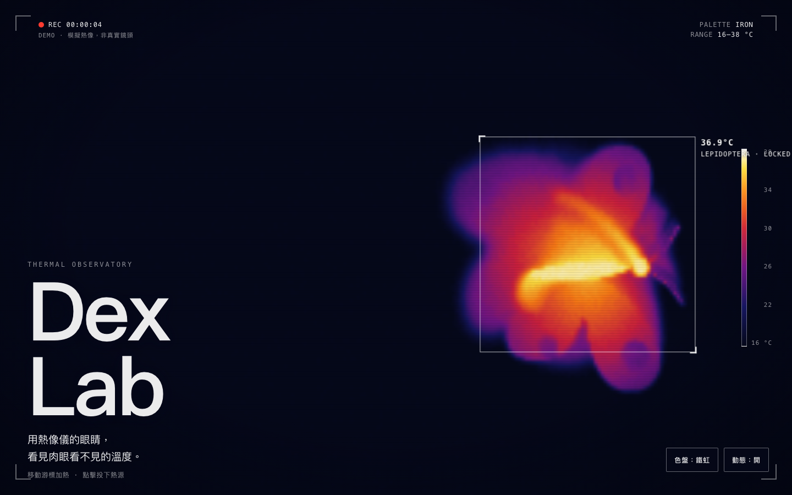
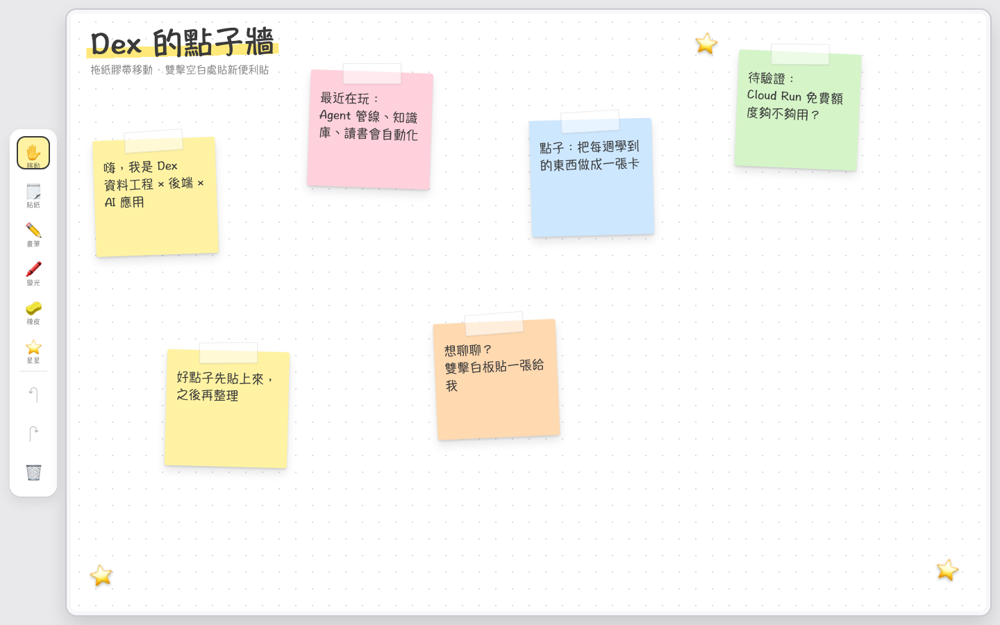
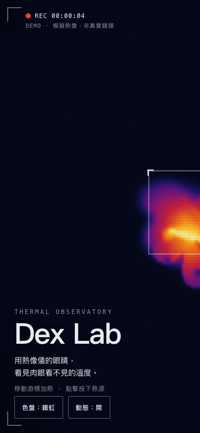
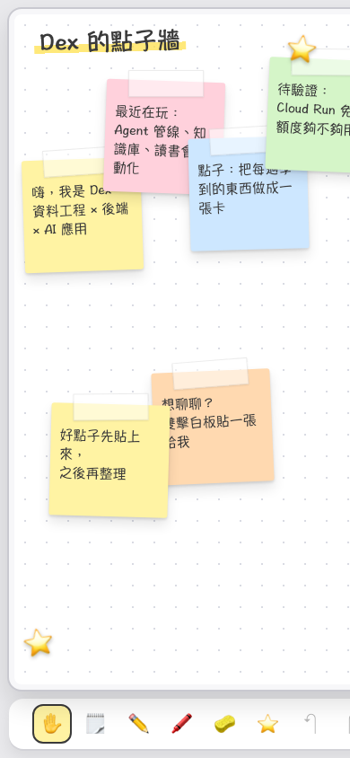

<p align="center"></p>

<h1 align="center">Web Style Recipes</h1>

<p align="center">An agent skill for experimental, memorable homepages, built from tested recipes and visual styles with real references.</p>

> This repository is documentation only. It does not contain the skill files.

---

## Why

Ask an AI agent for "a creative landing page" and you get the average of every landing page it has seen. Web Style Recipes gives your agent concrete recipes and named visual references. The result has a point of view and still works on a phone.



## What's inside

### 11 interactive homepage recipes

| # | Recipe | What happens | Good for |
|---|---|---|---|
| 01 | Retro Photo Booth | Open the curtain, countdown flash, four-frame black-and-white strip | Event check-in, parties, brand pop-ups |
| 02 | Thermal Camera | The cursor heats the scene; the subject leaves a cooling trail | Tech brands, portfolio heroes, product teasers |
| 03 | Audio Visualizer | Dotted symmetric waveform with phosphor afterglow and readouts | Musicians, podcasts, audio products |
| 04 | Sticky-Note Whiteboard | Draggable, drawable notes that persist | About pages, workshops, guestbooks |
| 05 | CCTV Surveillance | A surveillance HUD tracks the cursor; click to lock a close-up | Security and AI-vision brands, mystery campaigns |
| 06 | Kaleidoscope | Mirrored slices rotate; the mouse refracts the pattern | Luxury, fragrance, exhibitions, photo books |
| 07 | E-Stamp | Postmark, write a message, generate your own stamp | Brand stories, local brands, time-capsule campaigns |
| 08 | Kinetic Type | Tiny letters form the headline, scatter on hover, return | Writers, manifestos, launch pages |
| 09 | Pixel Room | Explore a late-night pixel apartment and unlock a secret room | Portfolios, creator homepages, easter-egg resumes |
| 10 | Gravity | The cursor is a gravity source; objects float, fall and collide | Labs, data brands, countdown pages |
| 11 | Hairline Isometric Figure | A fine-line isometric object answers the cursor with a fitting gesture | Service heroes, feature diagrams, empty states |

Each recipe includes:

- **Visible features**: concrete elements instead of adjectives ("deep red velvet curtain", not "retro feel")
- **A one-line flow** that doubles as acceptance criteria
- **An iteration order**, so each round changes one thing
- **Recipe-specific pitfalls** and a pre-delivery checklist
- **A ready-to-paste prompt** and a visual brief card

### 20 visual styles with references

| Print & Graphic | Motion & Film | 3D & Material | Interface & Game |
|---|---|---|---|
| Swiss Style | Kinetic Type | Clay 3D | Flat 2D |
| Risograph | Pop Art | Glassmorphism | Neo-Brutalism |
| Paper Collage | Synthwave | Y2K Chrome | Pixel Art |
| Bauhaus | Glitch | Particles | Isometric |
| Memphis | Vaporwave | Low Poly | |
| Line Art | | | |

Use a style on its own ("make this section Bauhaus") or layer it on a recipe (Pixel Room + pixel-art shadow rules).



## How it works

1. **Pick a direction.** Name a recipe or style, or say "explore" and the agent puts 3–4 directions side by side for you to choose from.
2. **Name the reference first.** Before designing, the agent states which classic work it borrows from (author, work, year).
3. **Build the flow first.** Version one only has to run the one-line flow end to end.
4. **Iterate one dimension at a time.** Skeleton → hero → main interaction → texture → secondary interaction → fallbacks and mobile.
5. **Check before delivery.** Reduced motion, touch input, permission-denied fallbacks, canvas and camera pitfalls.

Output is a single self-contained HTML file. Libraries load only from pinned CDN versions.

### Example prompts

```
Make my homepage feel like a thermal camera. Brand name: Lumen.
Build a pixel-room portfolio for a motion designer with three clickable objects.
Give me 4 style directions for a film festival page. Briefs only, no code.
Make the pricing section Risograph.
```

<p>

&nbsp;

</p>

## Compatibility

Works with agents that support the open SKILL.md standard and can write files, such as Claude Code, Codex CLI, Cursor and Gemini CLI. Built and tested with Claude Code.

Requirements:

- Node.js, to preview with `npx serve .`
- A modern browser
- Optional: a webcam (photo booth, CCTV) or a microphone or audio file (audio visualizer)

## Known limitations

- Outputs flat HTML/CSS/JS, not framework components or state management.
- Camera and microphone recipes must be previewed through a local server, not by double-clicking the file.
- Built for experimental landing pages and portfolios, not dashboards or standard SaaS marketing pages.

## Get the skill

Available on [Agensi](https://www.agensi.io/). One-time purchase, future updates included.

## Credits

- Recipe topics were inspired by AI郵報 (AI Post Hub), "10 Vibe Coding website design ideas" (Joanna Chang, 2026): https://www.aiposthub.com/vibe-coding-website-ideas/
- Recipe 11 is based on Lucas Markes's Hairline: https://hairline.lucasmarkes.com/figures
- The aesthetic library draws on styles-gift, "20 styles, 20 references": https://styles-gift.vercel.app/

All features, flows, pitfalls and prompts in the skill are rewritten in the author's own structure, not copied from these sources.

## Author

Dex · AI developer × AI SaaS product manager, Taiwan · [daydreamdex.com](https://daydreamdex.com)

© 2026 DayDreamDex. All rights reserved. The text and images in this repository may not be redistributed without permission.
